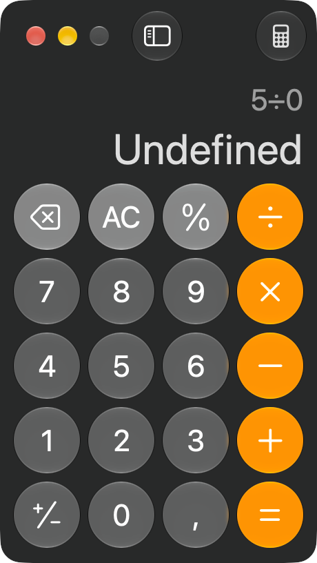
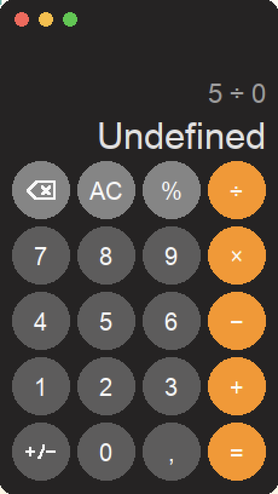

# Maculator

A pixel-faithful, **28 KB** Windows clone of the **macOS Calculator** (Basic mode,
`com.apple.calculator` 12.0) — reverse-engineered with
[REA](https://github.com/morluto/rea) and reimplemented from scratch in
**C + Win32**. No framework, no runtime, no dependencies: the executable only
imports `GDI32`, `USER32`, `KERNEL32` and the UCRT, so it runs standalone on any
Windows 10/11 — and, as shown below, under Wine.

| Original (macOS) | Maculator (running on macOS via Wine) |
|:---:|:---:|
|  |  |

## Download

Grab the prebuilt `Calculator.exe` (28 KB, no installer needed) from
[Releases](https://github.com/matteopollet/maculator/releases/latest) — or
build it yourself in one command (see [Build](#build)).

## Highlights

- **28 KB** single `Calculator.exe` — PE32+, x86-64, GUI subsystem
- **Exact rational arithmetic** — `99 999 999 × 99 999 999 = 9 999 999 800 000 001`, no float drift
- **Every quirk reproduced** — percent semantics, `Undefined`, repeat-`=`, two-stage `AC`, …
- **UI measured pixel-by-pixel** — same window size (230×408), same grid, same colors
- **Vector-drawn `⌫` / `+/−` icons** — zero font dependency for button glyphs
- Instant startup, ~2 MB RAM, no installer needed

## Behavior fidelity

Everything below was **observed on the genuine app**, then encoded in the test
suite (22 automated behavioral tests, `make test`):

| Input | Result |
|---|---|
| `2 + 3 × 4` | `14` — standard precedence |
| `200 + 10 %` | `220` — % of first operand after `+`/`−` |
| `200 × 10 %` | `20` — ÷100 after `×`/`÷` |
| `5 %` | `0,05` |
| `5 ÷ 0` | `Undefined` |
| `1 ÷ 3` | `0,33333333…` — 8 decimals + ellipsis |
| `1 + 2 =` then `=` | `5` — `=` repeats the last operation |
| `5 + 9` then `AC` | `5 +` — first `AC` clears entry only, second resets |
| `12 + 3` then `⌫` | `12 +` |
| `99 999 999 × 99 999 999` | `9 999 999 800 000 001` |

Plus: grouping `1 234 567`, decimal `,`, minus `−` (U+2212), leading-zero and
duplicate-`,` rejection, `±` on operands and results, result line hidden until `=`.

## Reverse-engineering process

The binary was never decompiled — the application was **observed while running**,
and every observation was turned into a test.

1. **Bundle inspection** — `rea inspect-plist` → `com.apple.calculator` 12.0
   (build 225), arm64. No `.nib`/storyboard: SwiftUI, layout lives in code.
2. **Accessibility tree** — `rea observe-native-ui` + `capture-native-ui-scenario`
   → 25 `AXButton` nodes, exact geometry: 48 px discs, 54 px pitch, grid origin
   (10, 133), window 230×408.
3. **Pixel forensics** — screenshots + pixel sampling → exact colors
   (`#252323` background, `#5D5C5C` digits, `#858585` top row, `#FF9402`
   operators) and glyph metrics (digit cap-height 15 px, result 22 px).
   Interesting catch: the *inactive* window is all-gray — the orange operators
   only appear when focused, visible by comparing the two original captures.
4. **Behavioral probing** — osascript-driven clicks and keystrokes against the
   real UI ([tools/calcpress.sh](tools/calcpress.sh)) → the full input→output
   matrix: `%` rules, `÷0`, `AC` staging, `⌫`, repeat-`=`, …
5. **Runtime validation** — `rea observe-native-calls` (LLDB) on a probe binary
   ([tools/percent_probe.c](tools/percent_probe.c)) confirming the two distinct
   percent code paths through argument registers.
6. **Specification** — everything frozen into [SPEC.md](SPEC.md) *before*
   writing a single line of the port.

SHA-256-signed evidence records are kept in [docs/evidence](docs/evidence/),
original captures in [docs/screenshots](docs/screenshots/).

## Build

```sh
# Cross-compile from macOS
brew install mingw-w64
make            # → Calculator.exe

# Cross-compile from Linux (Debian/Ubuntu)
sudo apt install mingw-w64
make

# Or on Windows with MSVC
cl /O2 src/calculator.c /link gdi32.lib user32.lib
```

## Test

```sh
make test       # builds the logic against macOS stubs, runs the 22-scenario matrix
```

The test harness ([tests/calc_test.c](tests/calc_test.c)) compiles the real
`calculator.c` with [tests/calc_stub.h](tests/calc_stub.h) standing in for the
Win32 API, then replays the exact scenarios observed on the genuine app.

## Try it on macOS

```sh
tools/run_wine.sh   # launches Calculator.exe under Wine
```

Expects [Gcenx Wine builds](https://github.com/Gcenx/macOS_Wine_builds) extracted
to `~/Applications/Wine Staging.app` (Rosetta required on Apple Silicon).
`WINEPREFIX` defaults to `~/.winecalc` and can be overridden.

## Layout

```
src/calculator.c   the whole app — Win32 window, GDI painting, shunting-yard
                   parser, int64 rational arithmetic, vector glyphs
tests/             behavioral harness + Win32 stubs (runs natively on macOS)
tools/             probing & analysis tools used to extract the spec
docs/              evidence records, screenshots
SPEC.md            the measured specification (FR)
```

## Known deltas

- Segoe UI rendering on Windows vs SF Pro on macOS — metrics were matched,
  glyph shapes differ subtly
- The toolbar icons (history / converter) are drawn but not functional
- `⌫` stays visible on `0` — the real app hides it (dynamic grid)
- Basic mode only — no Scientific/Programmer modes, no unit conversion

## License

[MIT](LICENSE) — applies to the code in this repository. Calculator's visual
design and the name "Calculator" belong to Apple Inc.; this is an independent,
educational reimplementation, not affiliated with or endorsed by Apple.
